<h1 align="center">hwppipe</h1>

<p align="center">
  <b>한글(HWPX) 문서를 RAG와 지식 그래프가 바로 쓰는 Markdown · JSON · 그래프로</b>
</p>

<p align="center">
  <a href="https://github.com/sjoon21/hwppipe/actions/workflows/ci.yml"></a>
  
  
  <a href="https://github.com/sjoon21/hwppipe/blob/main/LICENSE"></a>
</p>

<p align="center">
<picture>
  <source media="(prefers-color-scheme: dark)" srcset="https://raw.githubusercontent.com/sjoon21/hwppipe/main/docs/assets/pipeline-dark.svg">
  
</picture>
</p>

hwppipe는 공공기관과 기업이 쓰는 한글 문서(HWPX)를 LLM 파이프라인에 넣기 좋은 형태로 바꾼다. 병합 셀과 중첩 표를 그대로 살리고, 제목 계층과 원본 위치를 모든 블록에 남기며, 문서 구조를 노드·엣지 그래프로도 내보낸다. 출력에 담지 못한 정보는 조용히 버리지 않고 손실 보고서에 적는다.

> **English summary.** hwppipe converts HWPX documents (the XML-based Hangul word-processor format used across Korean government and enterprises) into LLM-ready outputs: Markdown for embedding, block-level JSON for chunking, a node/edge `graph.json` for ontologies and graph databases, and byte-identical figures. Merged and nested table cells are preserved, and anything that could not be represented is listed in a loss report. Pure Python; the only dependency is `lxml`.

## 왜 hwppipe인가

- **표를 잃지 않는다.** `rowspan`·`colspan`과 셀 안의 표를 그대로 살린다. HTML 표 대신 GFM 표(`[병합 2×2]` 주석)로도 쓸 수 있다.
- **구조를 남긴다.** 개요 기능으로 제목을 판정하고, 개요가 없는 공문서는 "1." "가." 같은 번호 패턴과 글자 모양으로 제목을 추정한다. 쪽 나눔을 뺀 모든 블록에 `id`와 `loc`(원본 위치)이, 본문 블록에는 `heading_path`(속한 제목 계층)가 붙는다.
- **그래프로 바로 적재한다.** `graph.json`의 노드 id는 `document.json`의 블록 id와 같다. 청크를 검색한 뒤 그래프에서 위아래 맥락을 따라갈 수 있다.
- **본문과 부속을 나눈다.** 머리말·꼬리말, 각주·미주, 글상자, 숨은 설명, 메모를 본문과 섞지 않는다. 메모에는 작성자와 메모가 달린 본문 글을 함께 남긴다.
- **잃은 것을 숨기지 않는다.** `원본 글자 수 = 출력 글자 수 + 손실 글자 수`가 항상 맞도록 집계하고, 손실 요소의 종류와 위치를 `report.json`에 적는다.
- **입력을 믿지 않는다.** 압축 폭탄 한도, 외부 엔티티를 끈 XML 파서, 경로 조작을 막는 그림 파일 이름을 쓴다. 일부가 깨진 문서는 살릴 수 있는 만큼 변환하고, 암호 입력란의 값은 내보내지 않는다.

## 빠른 시작

Python 3.10 이상이 필요하다.

```bash
pip install hwppipe
pip install git+https://github.com/sjoon21/hwppipe   # 최신 개발판
```

```bash
hwppipe 공문.hwpx -o out/                         # 파일 하나 → out/공문/
hwppipe ./문서함/ -o out/                          # 폴더 → 하위 폴더 구조를 재현하고 out/report.json에 요약
hwppipe 공문.hwpx -o out/ --table-format gfm       # 표를 HTML 대신 GFM 파이프 표로
hwppipe 공문.hwpx -o out/ --unframe-layout-tables  # 테두리 없는 틀 표를 문단으로 풀어 씀(md에만 적용)
```

```python
from hwppipe import parse, to_graph, to_markdown

doc = parse("공문.hwpx")                 # 파일을 쓰지 않고 document.json과 같은 dict를 돌려준다
for b in doc["blocks"]:
    if b["type"] != "page_break":
        print(b["id"], b["type"], b["heading_path"], b.get("text", "")[:40])

graph = to_graph(doc)                    # {"nodes": [...], "edges": [...]}
markdown = to_markdown(doc, table_format="gfm")
```

> 0.x 버전 동안은 출력 형식이 바뀔 수 있다. `document.json`의 `schema_version`과 [CHANGELOG](https://github.com/sjoon21/hwppipe/blob/main/CHANGELOG.md)로 변경을 확인한다.

## 출력

```
out/<문서명>/
├── document.md     # 사람과 LLM이 읽는 본문(임베딩 입력)
├── document.json   # 블록 단위 구조 데이터(청킹 입력)
├── graph.json      # 노드·엣지 그래프(온톨로지·그래프 DB 입력)
├── figures/        # HWPX 안의 그림 원본(바이트 단위로 동일)
├── figures.json    # 그림 매니페스트: 원본 이름, 본문 위치, 캡션, 크기, sha256
└── report.json     # 상태·개수·손실·경고
```

`document.json`의 블록은 다음과 같다. 셀 안의 문단도 같은 형태이며, `loc.in`이 `tbl-001[0,2]`처럼 어느 셀인지 알려 준다.

```json
{"id": "h-0002", "type": "heading", "level": 2, "prefix": "가.", "text": "추진 일정",
 "heading_source": "outline", "heading_path": ["1. 사업 개요", "가. 추진 일정"],
 "loc": {"section": 0, "para": 2}, "equations": []}
```

병합 셀이 있는 3×3 표는 `document.md`에서 다음처럼 나온다. 위는 기본값(HTML), 아래는 `--table-format gfm`이다.

```markdown
<!-- table:tbl-001 -->
<table><tr><td rowspan="2" colspan="2">1</td><td>2</td></tr><tr><td>3</td></tr><tr><td>5</td><td colspan="2">4</td></tr></table>
```

```markdown
| 1 [병합 2×2] |  | 2 |
| --- | --- | --- |
|  |  | 3 |
| 5 | 4 [병합 1×2] |  |
```

<details>
<summary><code>document.md</code>의 요소별 표현</summary>

| 요소 | 표현 |
|------|------|
| 표 | `<!-- table:tbl-001 -->` 다음에 HTML `<table>`. GFM 모드에서 셀 안 표는 `[표 tbl-002]`로 참조하고 부모 표 뒤에 따로 쓴다. |
| 그림 | `` |
| 수식 | `$LaTeX$` 다음 줄에 `<!-- hwpeq: 한컴 원본 -->`, 캡션은 그다음 줄 |
| 각주·미주 | `[^fn-1]`, `[^en-1]`. 정의는 문서 끝에 모은다. |
| 머리말·꼬리말 | `> [머리말 · 양쪽] …` |
| 글상자 | `> [글상자] …`. 도형 캡션도 이 안에 쓴다. |
| 숨은 설명 | 문서 끝에 `> [숨은 설명] …` |
| 메모 | 문서 끝에 `> [메모 · 작성자 · 날짜] …`, 다음 줄에 `붙은 글: …` |
| 양식 컨트롤 | 체크 상자 `☑ 이름`/`☐ 이름`, 라디오 단추 `◉`/`○`, 입력란은 입력값 |

</details>

## 그래프로 보기

<p align="center">
<picture>
  <source media="(prefers-color-scheme: dark)" srcset="https://raw.githubusercontent.com/sjoon21/hwppipe/main/docs/assets/graph-dark.svg">
  
</picture>
</p>

제목 아래 블록은 그 제목에 속하고(`CONTAINS`), 하위 제목은 상위 제목에 속한다. 읽는 순서는 `NEXT`, 각주 참조는 `REFERS_TO`, 메모와 숨은 설명은 `ANNOTATES`로 잇는다. 노드 속성 값은 문자열·숫자·불리언·문자열 목록뿐이라 Neo4j 같은 그래프 DB에 그대로 넣을 수 있다. 노드·엣지 종류와 Neo4j 적재 예는 [docs/schema.md](https://github.com/sjoon21/hwppipe/blob/main/docs/schema.md#graphjson)에 있다.

## RAG에 쓰기

[examples/chunk_rag.py](https://github.com/sjoon21/hwppipe/blob/main/examples/chunk_rag.py)는 hwppipe 출력으로 청크를 만드는 예제다. 같은 제목 아래 블록을 모으고, 각주를 본문 안에 풀어 넣고, 긴 표는 머리 행을 반복하며 행 단위로 나눈다.

```bash
python examples/chunk_rag.py 공문.hwpx --max-chars 1200 > chunks.jsonl
```

출력의 한 줄(보기 좋게 줄을 나눔):

```json
{
  "id": "502d75c28981-0003",
  "text": "1. 사업 개요 > 가. 추진 일정\n\n| 단계 [병합 1×2] |  |\n| --- | --- |\n…",
  "metadata": {
    "source": "공문.hwpx",
    "heading_path": ["1. 사업 개요", "가. 추진 일정"],
    "block_ids": ["h-0002", "tbl-001"],
    "section": 0
  }
}
```

`block_ids`로 `document.json`·`graph.json`에 되돌아갈 수 있으므로, 검색된 청크의 상위 제목·이웃 문단·각주를 그래프에서 더 가져올 수 있다.

## 지원 범위

| 지원 | 지원하지 않음 |
|------|---------------|
| 본문, 표(병합·중첩), 그림, 묶음 개체, 글상자, 글맵시, 수식, 각주·미주, 머리말·꼬리말, 메모, 숨은 설명, 변경 추적(삭제 구간 제외), 개요 번호·문단 번호, 글자 겹치기, 덧말, 양식 컨트롤(체크 상태·입력값) | `.hwp`(HWP 5.0 바이너리), 암호화된 문서, 차트·OLE 개체의 내용, 쪽 번호 같은 조판 결과 |

지원하지 않는 요소를 만나면 `report.json`의 `losses`에 종류와 위치를 기록한다. 배포용 문서 판별은 실제 샘플로 검증하지 못했다.

## 품질과 검증

- **공개 HWPX 3,186개로 검사한다.** [hwpxlib](https://github.com/neolord0/hwpxlib)·[python-hwpx](https://github.com/airmang/python-hwpx)·[rhwp](https://github.com/edwardkim/rhwp)의 공개 문서에 대해 문서마다 다음을 확인한다.
  - 처리되지 않은 예외가 없다.
  - 글자 수 균형식이 맞는다.
  - 그림 바이트가 원본과 같다.
  - 그래프 엣지의 끝점이 모두 있고, 제목 계층이 `heading_path`와 일치한다.
  - 깨진 표 격자는 경고로 알린다.
  - 같은 입력에서 같은 출력이 나온다.
- **손상 입력에 견딘다.** 예제 문서를 고정 시드로 망가뜨린 150개 입력을 테스트에 넣었다. 손상 입력에서도 예외 없이 `ok`·`partial`·`skipped` 가운데 하나로 끝난다.
- **제목 추정을 정답과 비교한다.** 실문서 3개에 대해 사람이 만든 제목 정답과 정밀도·재현율을 잰다.
- **충분히 빠르다.** 표 110개·그림 75개가 든 7.4MB 공문서를 0.15초 안팎에 읽는다(Apple M 계열 기준).

## 문서

- [출력 형식(docs/schema.md)](https://github.com/sjoon21/hwppipe/blob/main/docs/schema.md): `document.json`·`graph.json`·`figures.json`·`report.json`의 모든 필드
- [HWPX 형식 조사 노트(docs/hwpx-format.md)](https://github.com/sjoon21/hwppipe/blob/main/docs/hwpx-format.md)
- [변경 기록(CHANGELOG.md)](https://github.com/sjoon21/hwppipe/blob/main/CHANGELOG.md)
- [기여 안내(CONTRIBUTING.md)](https://github.com/sjoon21/hwppipe/blob/main/CONTRIBUTING.md)

## 라이선스와 고지

MIT. 수식 기호 대응표(`src/hwppipe/_eqsymbols.py`)는 [hml-equation-parser](https://github.com/OpenBapul/hml-equation-parser)에서 가져온 Apache-2.0 자료다. 서드파티 자료는 [THIRD_PARTY_NOTICES.md](https://github.com/sjoon21/hwppipe/blob/main/THIRD_PARTY_NOTICES.md)에 적었다.

본 제품은 한컴의 HWP 문서 파일(.hwp) 공개 문서를 참고하여 개발하였습니다.
